# Segundo parcial - Bases de Datos II

## Biblioteca Municipal de Cartago

Solución en MariaDB para registrar préstamos y devoluciones, calcular multas, auditar cambios en socios y controlar el acceso mediante roles y usuarios.

## Entorno

- MariaDB en el contenedor Docker `bbdd_mariadb`.
- MySQL Workbench como cliente.
- Base de datos: `parcial2_biblioteca`.

## Archivos

| Archivo | Contenido |
|---|---|
| `parcial2_base.sql` | Script base original, sin modificar. Crea las tablas y los datos iniciales. |
| `01_funcion.sql` | Función de multa y consulta de préstamos activos. |
| `02_procedimientos.sql` | Procedimientos para registrar préstamos y devoluciones. |
| `03_triggers.sql` | Triggers de inventario y auditoría. |
| `04_vistas.sql` | Vistas de socios y préstamos activos. |
| `05_seguridad.sql` | Roles, privilegios, usuarios y restricciones. |
| `06_pruebas.sql` | Consultas y llamadas para comprobar los requerimientos. |
| `capturas/` | Evidencias de las pruebas. |

## Pasos de ejecución

1. Iniciar el contenedor `bbdd_mariadb` y conectarse desde Workbench como `root`.
2. Ejecutar `parcial2_base.sql`. Debe aparecer el mensaje `Base del parcial creada correctamente` y los conteos de 6 socios, 8 libros y 8 préstamos.
3. Ejecutar, en este orden, `01_funcion.sql`, `02_procedimientos.sql`, `03_triggers.sql`, `04_vistas.sql` y `05_seguridad.sql`.
4. Ejecutar `06_pruebas.sql` por apartados. Las llamadas que comprueban validaciones deben ejecutarse por separado, porque generan errores intencionales.
5. En las pruebas con transacciones, ejecutar cada bloque una sola vez, tomar la captura y ejecutar `ROLLBACK` en la misma conexión antes de iniciar otra transacción.
6. Para las pruebas de seguridad, abrir una conexión con cada usuario, usando el mismo servidor y puerto de la conexión root. Ejecutar únicamente el apartado correspondiente a ese usuario.

El script base elimina y vuelve a crear la base de datos. Para reconstruir la solución hay que volver a ejecutar los archivos del 01 al 05. Si los usuarios y roles ya existen en el servidor, sus instrucciones de creación no deben repetirse sin preparar antes esas cuentas.

## Objetos creados

### Función `fn_calcular_multa`

Recibe la fecha límite y una fecha de referencia. Retorna `0` si no hay retraso; de lo contrario, cobra $1.500 por día, hasta un máximo de $30.000. Retorna un `DECIMAL(10,2)` y se utiliza en las consultas, la vista de préstamos activos y el procedimiento de devolución.

### Procedimiento `sp_registrar_prestamo`

Recibe el documento del socio y el ISBN del libro. Valida, en este orden:

1. Que el socio exista.
2. Que no esté suspendido.
3. Que no tenga multas registradas sin pagar.
4. Que tenga menos de tres préstamos activos.
5. Que el libro exista.
6. Que tenga ejemplares disponibles.

Si las validaciones se cumplen, registra el préstamo con fecha de hoy, fija un plazo de 15 días, descuenta un ejemplar disponible y retorna el identificador mediante el parámetro de salida.

### Procedimiento `sp_registrar_devolucion`

Comprueba que el préstamo exista y no haya sido devuelto. Calcula la multa con `fn_calcular_multa`, registra la fecha de devolución y cambia el estado a `DEVUELTO`. Retorna la multa mediante el parámetro de salida. La recuperación del ejemplar queda a cargo del trigger.

### Trigger `trg_prestamo_devuelto`

Después de actualizar un préstamo, suma un ejemplar disponible únicamente cuando el estado cambia de `ACTIVO` a `DEVUELTO`.

### Trigger `trg_auditar_socios`

Registra una fila en `auditoria_socios` por cada cambio en `email`, `telefono` o `estado`. Conserva el valor anterior, el nuevo, la fecha, `USER()` y `CURRENT_USER()`.

`USER()` identifica la sesión que realizó la operación. Dentro del trigger, `CURRENT_USER()` identifica al definidor cuyos privilegios se utilizan para ejecutarlo.

### Vista `vw_socios_publico`

Muestra el identificador, nombre y estado del socio. Enmascara el documento y el teléfono dejando visibles solo los últimos cuatro caracteres. No incluye el email.

### Vista `vw_prestamos_activos`

Combina `prestamos`, `socios` y `libros` mediante `JOIN`. Muestra los préstamos activos con sus fechas, días de retraso y multa estimada a la fecha actual.

## Roles y usuarios

| Rol | Privilegios |
|---|---|
| `rol_lector` | `SELECT` únicamente sobre las dos vistas. |
| `rol_bibliotecario` | Hereda `rol_lector` y tiene `EXECUTE` sobre los dos procedimientos y la función. |
| `rol_admin_biblioteca` | `SELECT`, `INSERT`, `UPDATE` y `DELETE` sobre `socios`, `libros` y `prestamos`; únicamente `SELECT` sobre `auditoria_socios`. |

| Usuario | Host | Rol activo por defecto |
|---|---|---|
| `u_lector` | `%` | `rol_lector` |
| `u_bibliotecario` | `%` | `rol_bibliotecario` |
| `u_admin_biblio` | `%` | `rol_admin_biblioteca` |

Las contraseñas de las cuentas de práctica se definen en `05_seguridad.sql`. El usuario `u_bibliotecario` tiene vencimiento de contraseña cada 60 días y un máximo de tres conexiones simultáneas.

## Pruebas y evidencias

Las fechas iniciales se calculan con `CURDATE()`. Por ello, los resultados esperados de retrasos corresponden a ejecutar las pruebas el mismo día que se carga la base.

### Función de multas

La prueba comprueba cero días, un día, cinco días y 25 días de retraso. Los resultados esperados son `0.00`, `1500.00`, `7500.00` y `30000.00`.

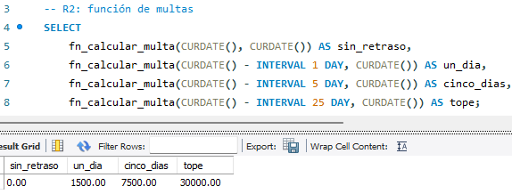

### Vistas

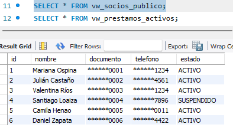

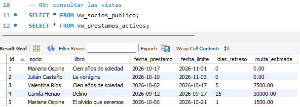

### Validaciones de préstamo

Cada validación genera un error mediante `SIGNAL SQLSTATE '45000'`.

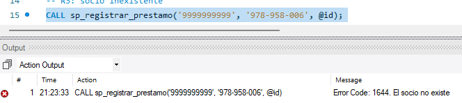

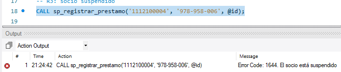

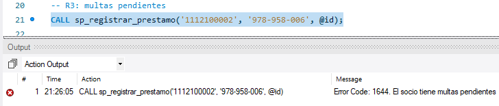

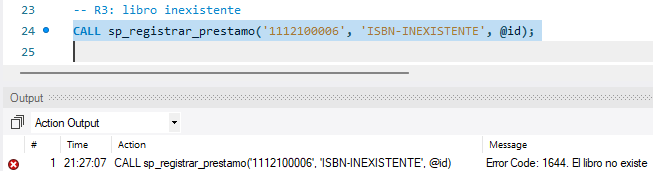

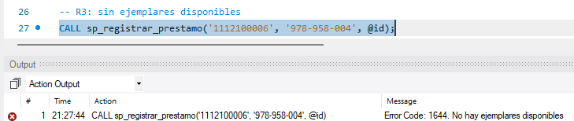

La prueba exitosa comprueba el identificador retornado, el plazo de 15 días, el estado activo y el descuento de inventario. Después se completan tres préstamos para Daniel y se rechaza el cuarto.

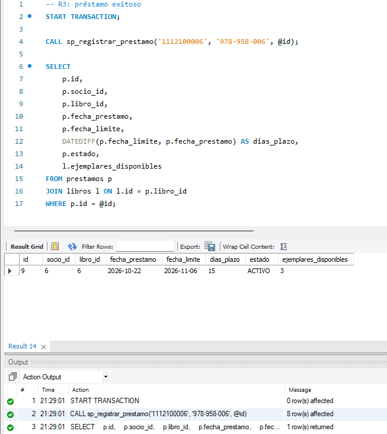

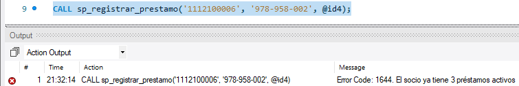

### Devoluciones e inventario

Se comprueban los errores por préstamo inexistente y préstamo ya devuelto. La prueba exitosa utiliza el préstamo 4: calcula una multa de $30.000 y recupera el ejemplar de Delirio, pasando de cero a uno disponible.

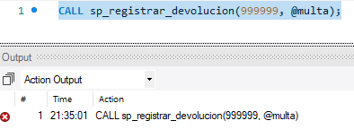

### Auditoría

Se actualizan email, teléfono y estado de Mariana dentro de una transacción. La consulta muestra tres registros con valores anteriores y nuevos, usuario de sesión y usuario de privilegios. Después se deshacen los cambios con `ROLLBACK`.

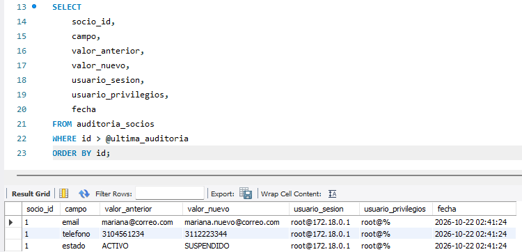

### Operaciones permitidas y denegadas

| Usuario | Operación permitida | Operación denegada |
|---|---|---|
| `u_lector` | Consultar `vw_socios_publico`. | Consultar directamente `socios`. |
| `u_bibliotecario` | Ejecutar `fn_calcular_multa`. | Actualizar directamente `libros`. |
| `u_admin_biblio` | Consultar `socios`. | Eliminar registros de `auditoria_socios`. |

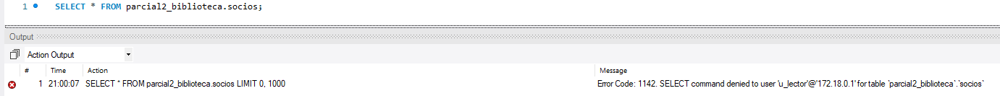

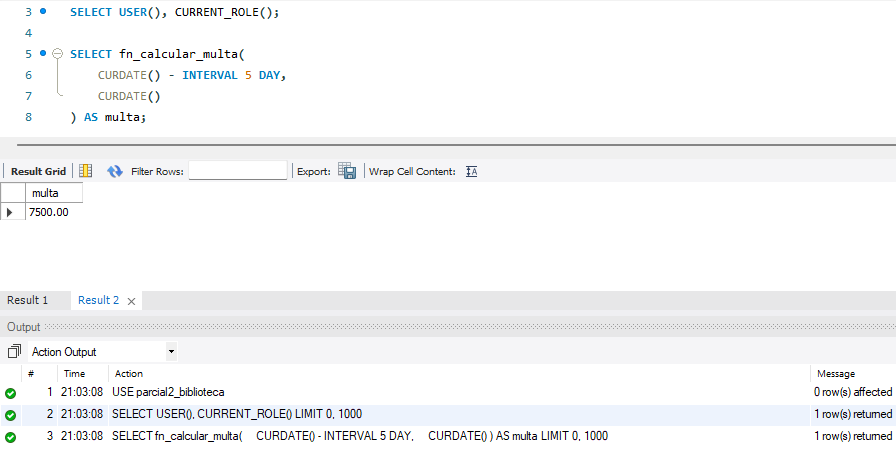

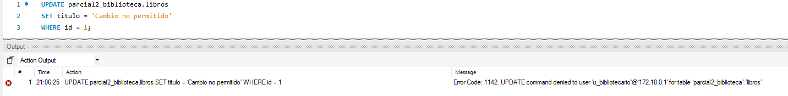

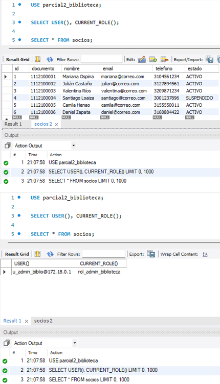

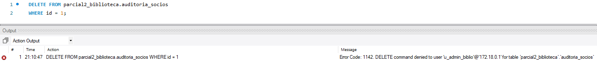

Los errores de validación y permisos incluidos en estas pruebas son resultados esperados.
